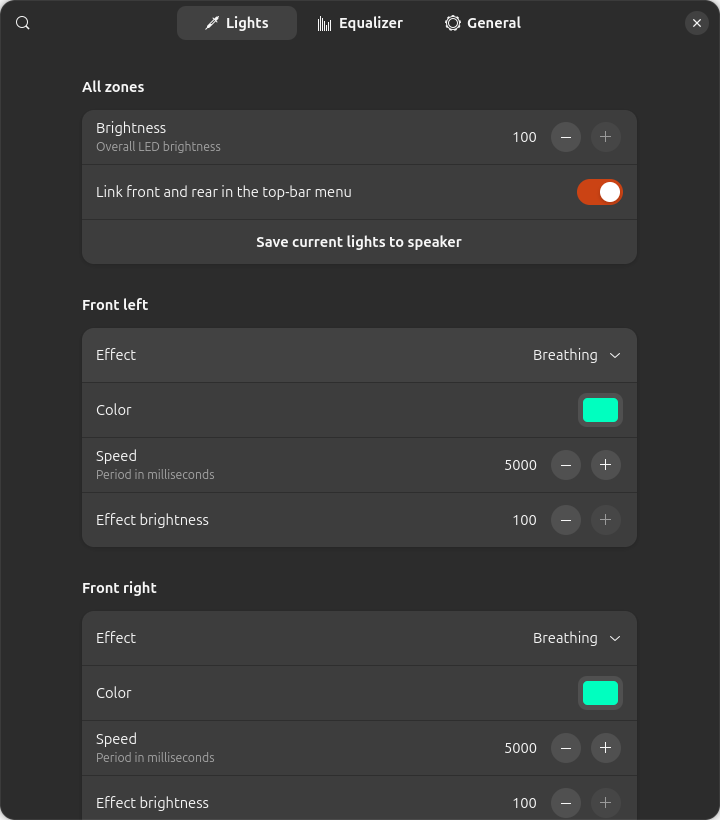
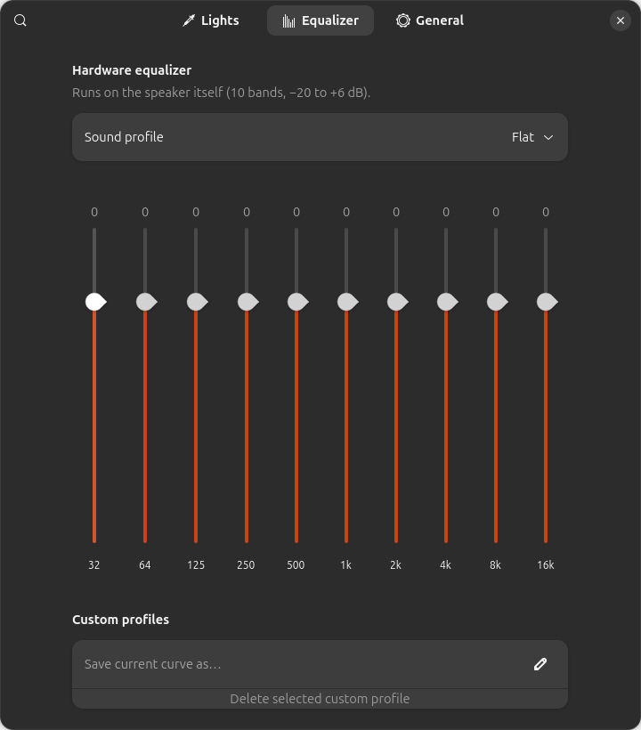
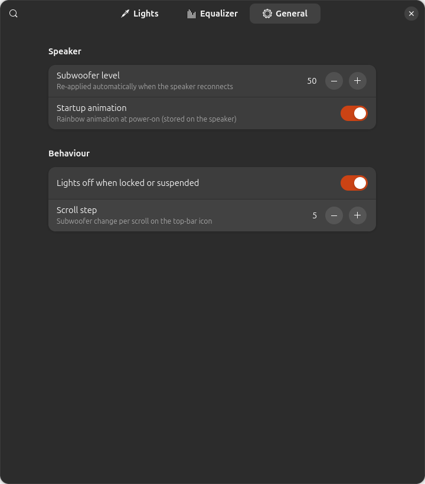

# G560 for GNOME

Control the **Logitech G560** gaming speakers on Linux, with no G HUB and no Windows. Set the **subwoofer level**, the **RGB lights** and the speaker's built-in **10-band equalizer** from an icon in the GNOME top bar.



| Equalizer | General |
|---|---|
|  |  |

## Features

- **Top-bar menu**
  - Subwoofer and light-brightness sliders.
  - Light effects (solid, breathing, color cycle, the speaker's own audio visualizer, off) for front and rear, or all linked.
  - Color swatches plus a **custom color picker** (hue, saturation, brightness, hex) with live preview. Your last 4 custom colors are remembered.
  - Sound-profile presets: Flat, Bass Boost, FPS/Footsteps, Movie, Vocal, and your own.
  - **Scroll on the icon** to change the subwoofer level.
- **Settings window:**
  - per-zone light settings (effect, color, speed, brightness);
  - a 10-band EQ editor with custom profiles;
  - a startup-animation toggle;
  - lights off on lock/suspend;
  - **Save lights to speaker**, so they also work without this software, for example on another PC.
- **`g560` command** for scripts and keyboard shortcuts.
- Settings survive reboots and USB replugs: a small background service re-applies them.

## Requirements

- A Logitech G560 connected over USB.
- **GNOME Shell 48, 49 or 50.** Tested on Ubuntu 26.04 with GNOME 50 and speaker firmware 122.3.23.
- Python 3.10 or newer, PyGObject, GUdev, gjs and systemd. The installer checks these and offers to install anything missing on Debian/Ubuntu.

| Distro | Packages |
|---|---|
| Debian / Ubuntu | `python3-gi gir1.2-gudev-1.0 gjs` |
| Fedora | `python3-gobject libgudev gjs` |
| Arch | `python-gobject libgudev gjs` |

## Install

```sh
git clone https://github.com/an-awful-person/G560-for-gnome.git
cd G560-for-gnome
./install.sh
```

Then **log out and back in once**, so GNOME Shell loads the extension. A speaker icon appears in the top bar.

The installer:
- works per user, in `~/.local`, without sudo;
- runs the tests and installs the `g560d` background service and the GNOME extension;
- tells you what to do if something is missing.

On first start, the service adopts whatever the speaker is currently doing, so your lights don't change.

**Update:** run `git pull` and then `./install.sh` again.

**Uninstall:** run `./install.sh uninstall`. Add `--purge` to also delete your settings in `~/.config/g560`.

**Check:** `./install.sh status` shows what's installed and the speaker's current state.

## Usage

### Top bar

Click the speaker icon for the sliders, light effects, colors and sound profiles. Click **+** after the color swatches to open the custom color picker. The speaker follows the sliders live, and **Apply** remembers the color. **Settings…** opens the full settings window, which you can also open from GNOME's *Extensions* app.

### Command line

```sh
g560 status                    # current state
g560 sub 60                    # subwoofer 0-100, or relative: g560 sub +5
g560 bright 50                 # light brightness 0-100
g560 led all solid ff0000      # targets: all, front, rear, front-left, front-right, rear-left, rear-right
g560 led front breathe 00ff00 --period 3000 --level 80
g560 led rear cycle --period 8000
g560 led all visualizer        # the speaker's built-in audio visualizer
g560 eq "Bass Boost"           # a profile, or ten gains in dB: g560 eq 3 2 1 0 0 0 0 0 0 0
g560 presets                   # list sound profiles
g560 save                      # store the current lights in the speaker
g560 startup off               # power-on rainbow animation on/off (stored in the speaker)
g560 probe                     # list the speaker's HID++ features (read-only)
```

Example GNOME keyboard shortcut (*Settings → Keyboard → Custom Shortcuts*): command `g560 sub +10`.

## Troubleshooting

| Problem | What to do |
|---|---|
| No icon in the top bar | Log out and back in after installing. Check `gnome-extensions info g560@an-awful-person.github.io` (it should say `ACTIVE`) and look for errors with `journalctl --user -b \| grep -i g560`. |
| Menu says "service not running" | Run `systemctl --user restart g560d` and check `journalctl --user -u g560d`. |
| Menu says "speaker not connected" | Check the USB cable. `lsusb \| grep 0a78` should list the G560. The service reconnects automatically. |
| Installer says the speaker "is not accessible" | Your distro doesn't give your user access to the speaker's hidraw device. Run `./install.sh --udev` (uses sudo once). |
| `g560: command not found` | `~/.local/bin` isn't on your PATH yet. Log in again, or run `~/.local/bin/g560`. |
| Lights or subwoofer change back | Another tool (OpenRGB, a G HUB VM) may be writing to the speaker as well. |

## How it works

```
GNOME top-bar extension ─┐
Settings window ─────────┼── D-Bus (org.g560.Daemon) ──> g560d ──> /dev/hidraw* ──> G560
g560 command ────────────┘                                │
                                                 ~/.config/g560/config.json
```

- **`g560d`** is a small Python service that runs as a systemd *user* service. It owns the speaker, stores your settings in `~/.config/g560/config.json` and sets them again on login, on USB replug and after suspend.
- The **extension** and the **command** are thin clients. If the service isn't running, the command talks to the speaker directly.
- The speaker is controlled with Logitech's **HID++ 2.0** protocol. See [docs/PROTOCOL.md](docs/PROTOCOL.md) for the byte-level details.

**Safety:** changes are written to the speaker's working memory, and only *Save lights to speaker* and *startup animation* write to its flash. The project only uses the HID++ settings commands described in [docs/PROTOCOL.md](docs/PROTOCOL.md). It never touches the speaker's firmware or EEPROM.

## Development

```sh
make test                          # Python unit tests + gjs color tests
python3 -m g560d status            # run the CLI from the source tree
python3 -m g560d.service           # run the service in the foreground (stop the installed one first)
gjs -m tools/screenshot_prefs.js   # re-render the README screenshots (needs the service running)
```

| Path | Contents |
|---|---|
| `g560d/` | Python package: HID++ transport (`hidpp.py`), speaker model (`device.py`), settings (`config.py`), D-Bus service (`service.py`), CLI (`cli.py`) |
| `extension/g560@an-awful-person.github.io/` | GNOME Shell extension: top-bar menu (`extension.js`), settings window (`prefs.js`), D-Bus client, color helpers |
| `data/` | systemd user unit, optional udev rule |
| `tests/` | unit tests |
| `tools/` | helper scripts |
| `docs/` | protocol notes, screenshots |

Contributions are welcome. Please run `make test` before opening a pull request. If you have a different G560 firmware version, the output of `g560 probe` is useful too.

## Credits

The protocol details build on [mugurc/g560-reverse-engineering](https://github.com/mugurc/g560-reverse-engineering) (LEDs, brightness, startup animation) and [hello-nexus/nexus-service#15](https://github.com/hello-nexus/nexus-service/pull/15) (subwoofer level).

## License

[MIT](LICENSE). This project is not affiliated with or endorsed by Logitech. "Logitech", "G560" and "G HUB" are trademarks of Logitech.
